# TabEx

面向 **Windows x64** 的多标签页文件浏览器，类似 Clover。保留原生 Windows 文件视图，并提供标签管理、左右分屏、搜索和常用工具。

**当前版本：v4.12**。修复打包 EXE 的 OCR 启动报错：统一 Qt 与 ONNX Runtime 使用的 C++ 运行库，并将 EXE 子进程实际中英文识别加入发布验收，检查失败不替换旧 EXE。详见[打包说明](#打包-exe)、[截图使用说明](#屏幕截图)和[更新记录](docs/DESIGN.md#changes)。

[下载发布版](https://github.com/caojinyuan/TabEx/releases/latest) · [功能动图](#demos) · [快速开始](#quickstart) · [使用说明](#usage) · [快捷键](#shortcuts) · [设计文档](docs/DESIGN.md)

## 功能动图

真实 Windows 界面的演示，覆盖 **11 项功能**，每张约 10–18 秒，配有操作字幕；拖拽演示带鼠标位置高亮，系统导航树已遮挡以保护隐私。动图录制于 v4.07，界面配色与当前版本略有不同，操作方式相同。完整步骤及后续重录方法见[演示与维护指南](docs/FEATURE_DEMOS.md)。

### 基础上手

**多标签浏览**：`Ctrl+T` 新建标签，在不同标签打开目录，点击标签快速切换。

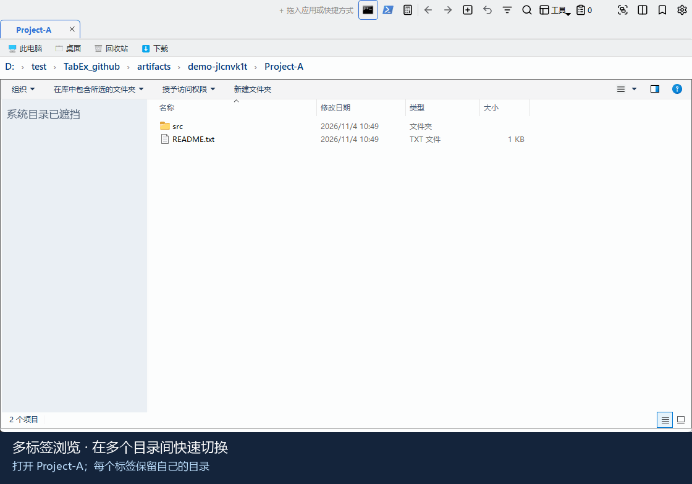

标签基础操作：新建、拖动排序、固定、关闭与恢复

拖动标签调整顺序；右键“固定”保留常用目录；`Ctrl+W` 关闭，`Ctrl+Shift+T` 恢复误关标签。

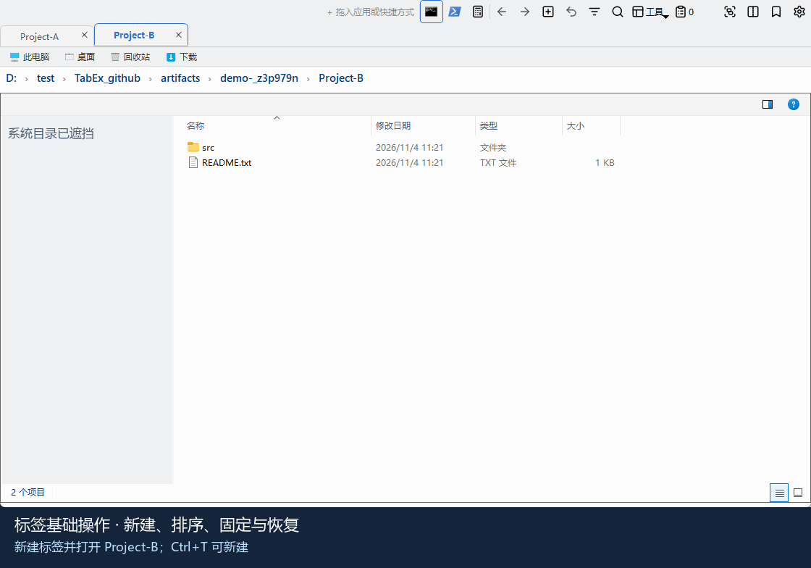

书签管理：添加目录、创建分类、保存后点击打开

`Ctrl+D` 添加当前目录，可就地新建书签文件夹；从书签栏分类菜单打开已保存的目录。

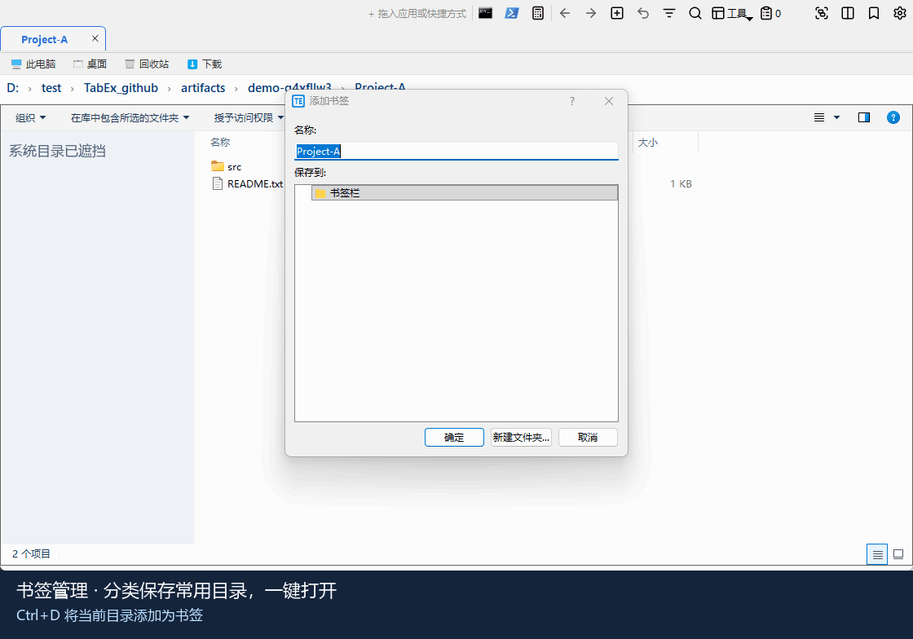

标题栏启动区：拖入 EXE 或 LNK、启动程序、排序和移除

将 `.exe` 或 `.lnk` 拖到标题栏“+ 拖入应用或快捷方式”；左键启动、拖动排序、右键移除，不删除原文件。

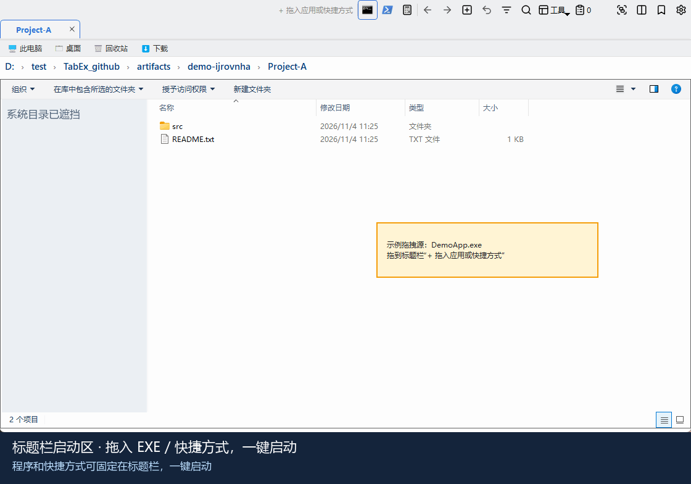

文件夹拖入标签栏：松开即打开新标签

将文件夹拖到标签栏（不是顶部的程序启动区），自动在新标签打开；原目录保持不变。

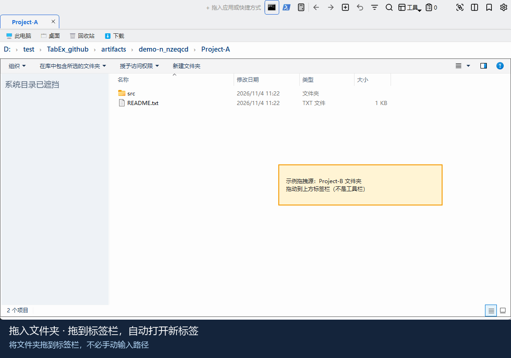

### 效率工具

屏幕截图：拖动选区、矩形与箭头标注、撤销、悬浮贴图

`Ctrl+Alt+Z` 开始截图；选区后添加标注，可撤销并复制、保存或贴图。演示选择贴图，不修改系统剪贴板。

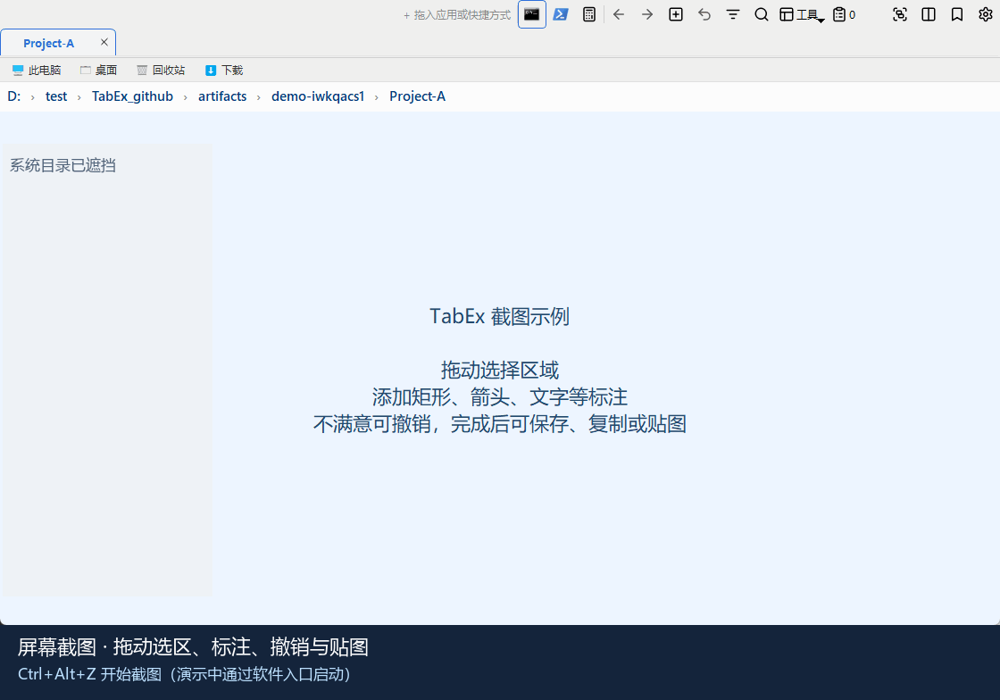

文件内容搜索：筛选源码文件，查看匹配行

`Ctrl+F` 打开搜索，关闭 Everything、勾选文件内容，输入关键词及文件类型；结果可预览匹配内容。

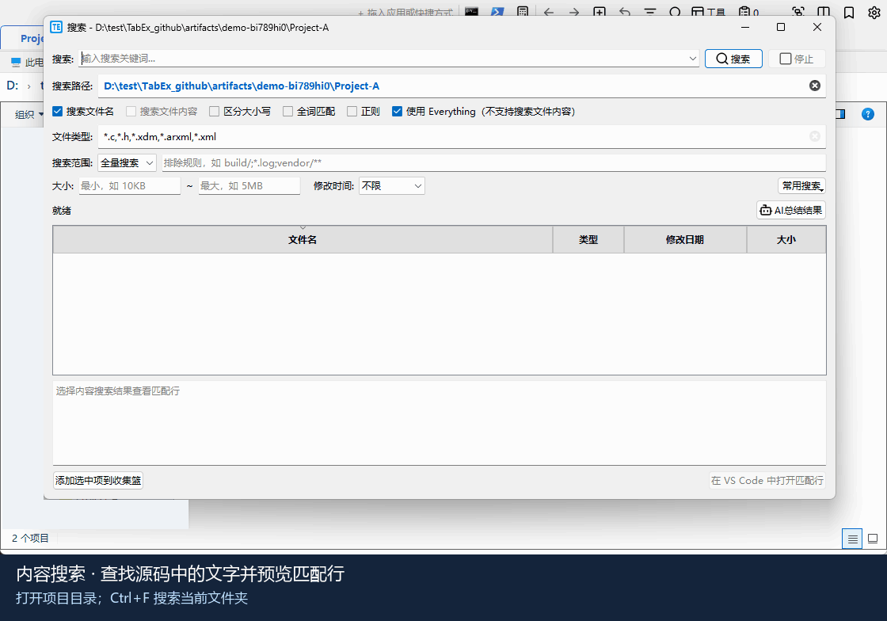

功能搜索：输入关键词，不翻菜单也能执行功能

`Ctrl+Shift+P` 打开功能搜索，输入“分屏”，选择“分屏对比”后回车执行。

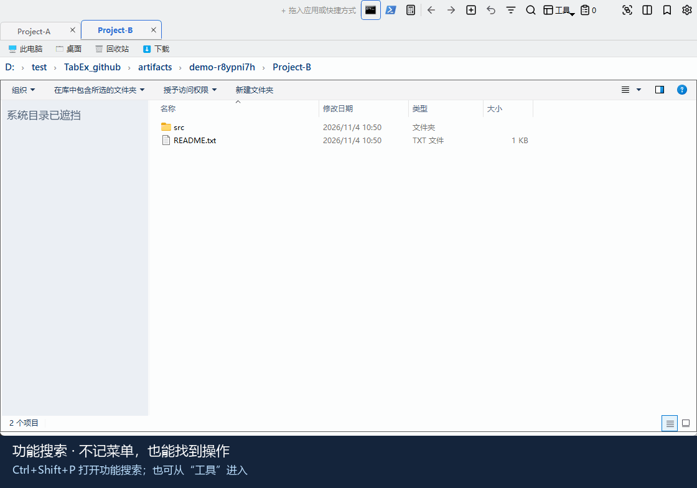

文件收集篮：跨目录收集引用、去重，清空不删除原文件

从“工具”添加选中项到收集篮，统一整理不同目录的文件；重复路径自动去重。

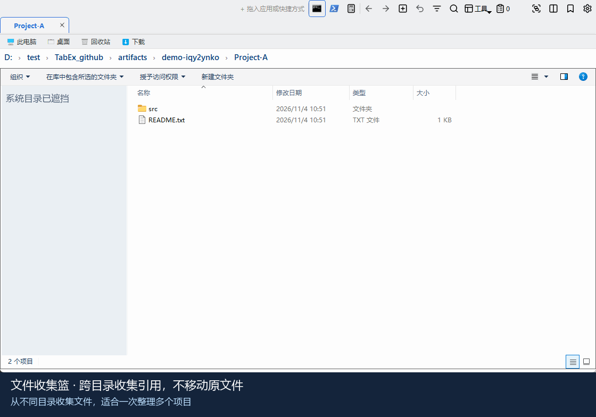

### 进阶功能

标签分组：F4 添加颜色分组，点击色块折叠或展开

`F4` 将当前标签及左侧连续未分组标签组成一组；点击分组名称，以约 500ms 的平滑动画折叠或展开，折叠只收起标签，不关闭目录。

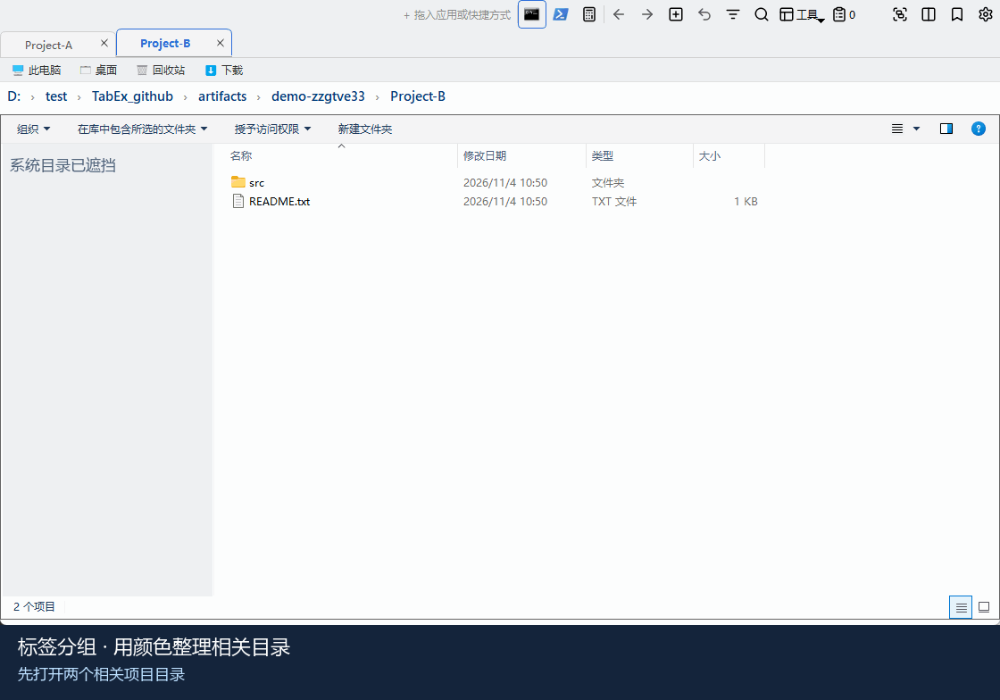

左右分屏与同步导航：两侧跟随进入对应子目录

`F3` 将当前标签移到右侧；开启“同步导航”后，一侧进入 `src`，另一侧跟随进入对应目录。

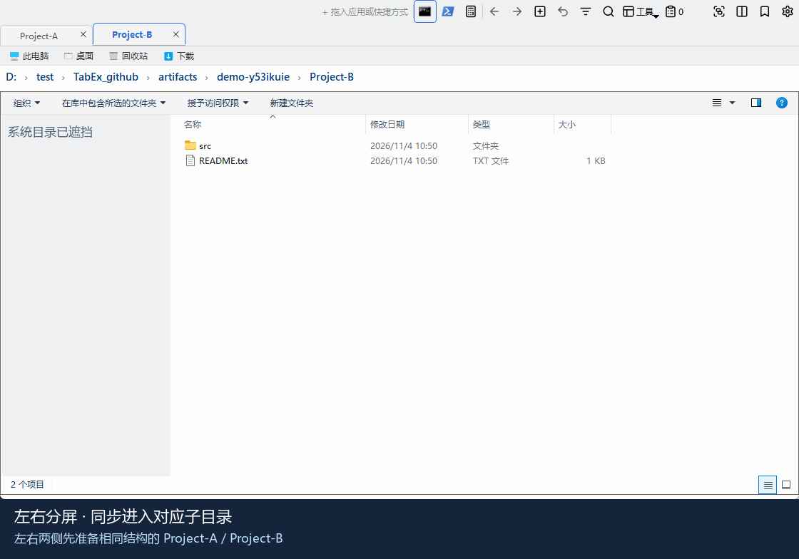

## 核心功能

- ✅ **多标签页浏览** - VS Code 风格扁平标签页，独立历史记录，支持拖拽排序，中键点击关闭；标签右键可复制路径、复制标签、移到另一侧、关闭其他/右侧标签
- ✅ **左右分屏对比** - 按 `F3` 或标题栏 `▫` 按钮，把当前标签移到右侧独立标签组（左右两组完全对等：都支持双击新建、关闭、固定、右键菜单，标签可在两组之间自由拖拽互转并带跨组拖拽预览）；再次 `F3` 把右侧标签移回左侧并关闭分屏；分屏状态会随会话保存，重启或意外关闭后自动恢复；可开启“分屏同步浏览”，一侧进入子目录或返回上级时另一侧跟随
- ✅ **标签分组增强（F4）** - 当前标签支持一键插入/取消分组颜色；取消分组仅影响当前标签，不会连带修改左侧标签；右键整组拖动保持原分组颜色，插入到其他组中间时会自动拆分为两个不同颜色分组；分组可命名、以约 500ms 的缓入缓出动画折叠/展开、整组取消或关闭；深色主题下分组底色更醒目
- ✅ **鼠标手势** - 文件区按住右键画线快速导航（后退/前进/新建/关闭标签等），带实时轨迹与方向提示，可在设置中开关
- ✅ **AI 助手侧边栏** - 可选启用的右侧聊天面板，支持目录操作、文件读写、脚本执行和安全确认；请求校验 HTTPS 证书，API 密钥加密保存
- ✅ **高 DPI 自适应** - 自动检测屏幕 DPI 并动态缩放 UI，高分屏显示清晰
- ✅ **VS Code 风格界面与颜色主题** - 扁平标签与顶部强调线、标题栏命令中心、VS Code 式状态栏/菜单/滚动条；内置 Light Modern、Dark Modern、Light+、Dark+、Monokai、Monokai Black（纯黑底配 Monokai 原色）、Solarized Light/Dark、One Dark Pro、GitHub Dark、高对比度（深/浅）和灰色主题，可跟随系统；“工具 → 颜色主题”中上下键实时预览，Windows 11 下系统标题栏同步配色
- ✅ **快速打开** - `Ctrl+P` 或点击标题栏命令中心，在已开标签、书签、常用目录和最近关闭的标签之间模糊查找并跳转，也可直接输入路径打开；输入 `>` 切换到查找功能
- ✅ **中英文界面** - 设置窗口底部切换中文 / English
- ✅ **网络位置断线提示** - 网络/映射盘位置打不开或超时时，在标签内显示原因及“重试”“重新连接”按钮，恢复后自动消失
- ✅ **标签页固定** - 固定常用文件夹，开机自动恢复
- ✅ **TortoiseGit 集成** - 标题栏快捷按钮，一键打开 Log/Commit/Git Bash（需安装 TortoiseGit 或 Git for Windows），支持变更文件图标修改功能
- ✅ **标题栏启动区** - 支持拖入应用、快捷方式或脚本（`.lnk/.exe/.bat/.cmd/.ps1`），一键启动、右键删除、拖拽排序（最多 20 个），并尽量解析目标程序图标避免快捷方式箭头覆盖
- ✅ **标题栏工具按钮** - 一键在当前标签页路径打开 cmd、PowerShell、Git Bash，或快速打开计算器
- ✅ **会话恢复** - 关闭时自动缓存标签，启动时智能恢复工作环境，支持窗口恢复提示；分组颜色、分屏右侧标签、同一路径重复标签页都会按关闭前状态恢复
- ✅ **当前目录快捷定位** - `Ctrl+G` 按关键字检索当前目录下的文件夹和文件名，多结果使用表格选择，并在当前目录直接选中目标
- ✅ **功能搜索** - `Ctrl+Shift+P` 或“工具 → 查找功能”，在窗口顶部弹出 VS Code 式快速输入：模糊匹配并高亮，最近用过的排在最前，右侧显示快捷键；显示不可用原因，上下方向键选择、回车执行，点到别处或 `Esc` 关闭
- ✅ **常用目录跳转** - `Ctrl+J` 按访问次数和最近访问排序列出去过的目录，输入关键词筛选后回车打开
- ✅ **快捷导航** - 前进/后退、面包屑导航（段间 `›` 下拉快速切换同级目录）、编辑模式路径自动补全、路径栏智能压缩
- ✅ **Everything 搜索** - 毫秒级全盘搜索，速度提升 100-1000 倍；搜索支持正则、按大小和修改时间筛选，可保存常用搜索条件
- ✅ **流式内容搜索** - ripgrep 边搜边显示，纯内容搜索不重复遍历目录；支持匹配行预览和 VS Code 行号跳转
- ✅ **上下文外部工具** - 可配置当前目录、选中文件、左右目录和匹配位置参数，提供 WinMerge / VS Code 预设；工具需自行安装，不随 TabEx 分发
- ✅ **工程搜索范围** - 可尊重 Git/ripgrep 忽略规则、排除构建和依赖目录；自定义排除规则可随常用搜索保存
- ✅ **文件收集篮** - 跨目录和搜索结果收集路径引用，去重后统一复制文件或路径；清空不删除原文件
- ✅ **QuickLook 空格预览（可选）** - 选中文件按空格即时预览，在设置中一键下载并启用，默认关闭
- ✅ **书签管理** - 层级书签、导入/导出；添加书签时在文件夹树中选择位置（默认书签栏），可就地新建文件夹；书签或配置文件损坏时保留原文件并提示，不会被默认内容覆盖
- ✅ **轻量级提示** - 右下角 Toast 消息，5秒自动消失，无需点击确认
- ✅ **自动监听 Explorer** - 新打开的资源管理器窗口自动嵌入为标签页
- ✅ **误操作保护** - Ctrl+Shift+T 恢复关闭的标签页（最多 20 个）
- ✅ **自定义快捷键** - 设置中可为各功能改键或停用，保存时检查重复和与 Explorer 文件操作的冲突；`Ctrl+1…9` 快速切换标签
- ✅ **屏幕截图** - 全局热键 `Ctrl+Alt+Z`（或 `工作区与文件工具` 菜单 → `屏幕截图`）：拖拽选区、单击自动选中窗口/子控件（滚轮切换层级）；标注支持矩形、椭圆、箭头、画笔、马赛克、文字、序号并可撤销；可复制、保存、贴图悬浮桌面；选区前按 `C` 取色，`Shift` 切换 HEX/RGB；选区后点击 `OCR` 可离线识别中英文、编辑并复制文字。详见下文“屏幕截图”
- ✅ **检查更新** - 默认关闭；可随时手动检查，也可在设置中开启每天自动检查，只提示不下载
- ✅ **文件系统监控** - 文件变化自动刷新（watcher + 低频轮询兜底），支持回收站恢复
- ✅ **智能自动刷新** - 当前标签主动监听文件修改并原地刷新（不丢失选中项、滚动位置和视图模式），后台标签自动降频，兼顾及时性与性能；标签右键可单独冻结/恢复自动刷新
- ✅ **智能状态栏** - 显示目录项目数、选中文件信息、总大小、修改时间；Git 仓库下实时显示仓库名、分支名（加粗高亮）和暂存/修改/未跟踪文件数（颜色标注，后台异步不阻塞 UI）
- ✅ **全面拖拽支持** - 文件夹拖拽到标签栏、目录树任意位置打开
- ✅ **多线程后台拷贝/删除** - 文件拷贝与删除支持后台多线程执行，减少界面阻塞；支持随时取消当前任务
- ✅ **单实例模式** - 右键菜单打开文件夹时在已有窗口新建标签页
- ✅ **开机启动** - 设置中勾选后，登录 Windows 时自动运行 TabExplorer.exe；EXE 移动位置后自动更新启动快捷方式
- ✅ **性能优化** - 大文件夹异步加载、分割器拖动节流、响应式布局；后台标签闲置后自动休眠，释放文件视图资源
- ✅ **长期运行稳定性优化** - 搜索窗口、Explorer 监控、标签页资源、聊天线程与定时器均增加清理与回收路径，降低长时间运行后的内存和句柄堆积风险
- ✅ **崩溃诊断包** - 自动记录异常与每 10 分钟的资源计数（私有内存、句柄、GDI/USER 对象、线程、标签页、QuickLook 内存等），无需额外开关，可一键导出脱敏 ZIP 便于长稳排查

## 快速开始

### 运行发布版（推荐）

1. 从 [Releases](https://github.com/caojinyuan/TabEx/releases/latest) 下载 `TabExplorer.exe`。
2. 放到便于长期使用、可写入配置和日志的目录，双击运行，无需安装 Python。

### 从源码运行

1. 下载或克隆仓库到本地。
2. 首次运行 [0_install_requirements.bat](0_install_requirements.bat)，自动准备项目本地 Python 和依赖。
3. 运行 [1_run_TabEx.bat](1_run_TabEx.bat) 启动。

首次安装需要联网；Python 和依赖保存在项目内，无需预装 Python，也不用手动激活环境。

### 打包 EXE

运行 [2_build_exe.bat](2_build_exe.bat)。构建机需要安装 **Microsoft Visual C++ 2015–2022 Redistributable x64（14.42 或更新版本）**。打包会把新版 C++ 运行库同时放入 EXE 根目录和 Qt 目录，避免 Qt 自带旧库导致 ONNX Runtime DLL 初始化失败；缺失或版本过旧会明确中止。

只有单元测试、EXE 主窗口检查和 **EXE 子进程实际中英文 OCR 识别**全部通过后，才替换 `TabExplorer.exe`。验收结果（含 `ocr` 字段）写入 `artifacts/release-runtime.json`；失败保留旧 EXE。发布的 EXE 已携带运行库和模型，用户不需要安装 Python。

### 第一次打开后

1. 在地址栏输入文件夹路径并回车，或通过书签进入目录。
2. 用 `Ctrl+T` 新建标签，或把文件夹拖到标签栏；标签可拖动排序，右键可固定、复制或关闭其他标签。
3. 找不到某个功能时，按 `Ctrl+Shift+P` 输入“分屏”“比较”“工作区”“截图”等关键词查找；按 `Ctrl+P` 或点击标题栏中间的命令中心，可快速跳到已开标签、书签和常用目录。
4. 在“工具 → 颜色主题”中用上下键预览并选择主题；在设置中调整语言、快捷键和需要启用的工具；不希望接管新打开的 Explorer 窗口时，可关闭自动监听。

### 可选工具需要什么

| 功能 | 使用前准备 |
|---|---|
| Everything 文件名搜索 | 另外安装并运行 [Everything](https://www.voidtools.com/)，等待索引完成；命令行组件已内置 |
| 文件内容搜索 | ripgrep 已内置，无需另装 |
| QuickLook 空格预览 | 在设置中下载并启用，默认关闭 |
| AI 助手 | 在设置中填写对应服务配置 |
| VS Code / WinMerge / TortoiseGit | 自行安装需要的工具；可在外部工具配置中检查路径 |

## 使用说明

### 标签、书签与工作区

- `Ctrl+T` 新建、`Ctrl+W` 关闭标签（也可中键点击标签）；误关后用 `Ctrl+Shift+T` 恢复。
- `Ctrl+P` 在已开标签、书签、常用目录和最近关闭的标签之间快速跳转，也可直接输入路径打开。
- `Ctrl+D` 将当前目录加入书签，可选择保存位置并新建书签文件夹；`Ctrl+J` 跳转常用目录。
- `F4` 为当前标签及其左侧连续未分组标签创建分组；再次按下只取消当前标签分组。分组可命名、折叠和整组移动。
- “工具 → 工作区”中的“保存命名工作区 / 打开命名工作区”可管理常用的两侧标签组合；打开工作区会追加标签，不替换当前浏览内容。
- 会话恢复可在关闭后保存标签及分屏状态；固定标签、缓存标签的选项可在设置中调整。

### 左右分屏与目录比较

1. 按 `F3` 将当前标签移到右侧分屏，再次按下关闭分屏。
2. 分屏操作条会显示当前操作侧，以及“同步导航”和“目录差异比较”入口。
3. 开启同步导航后，一侧进入子目录或返回上级，另一侧按相同的相对路径跟随；目标不存在时只提示，不强制跳转。
4. “目录差异比较”可查看差异，并按确认后的操作复制到另一侧；也可调用 VS Code / WinMerge 查看文件内容差异。

同步导航**不联动滚动条、选中项或文件内容**；搜索、导航和终端等操作以当前操作侧为准。

### 搜索文件名和文件内容

- **文件名**：打开一个实际文件夹，按 `Ctrl+F`；启用 Everything 可使用其索引搜索文件名。
- **文件内容**：取消勾选 Everything，再勾选“搜索文件内容”；结果可显示匹配片段，并支持在 VS Code 中打开匹配行。
- **缩小范围**：按文件类型、大小、日期等筛选；搜索工程源码时可选择工程文件模式，尊重忽略规则并排除构建目录。
- **常用搜索**：保存经常使用的条件，下次直接套用；不保存搜索路径。
- **只找当前目录中的项目**：使用 `Ctrl+G`，找到后在当前文件列表中选中。

### 复制、删除与文件任务

- 原生文件列表的 `Ctrl+C` / `Ctrl+V` 等系统操作保持不变。
- `Alt+C` 将选中项放入内部剪贴板，`Alt+V` 在当前目录后台粘贴；`Alt+Delete` 后台移入回收站。
- 从“工具 → 文件任务”查看进度、失败原因、取消和续作；`Alt+Q` 可取消当前后台复制/删除。面板保留最近 50 条已完成任务，更早的记录自动移除。
- 跨多个目录收集文件时，可先“添加选中项到收集篮”，再统一复制文件或路径；清空收集篮不会删除原文件。

**取消不等于回滚**：已经完成的复制、重命名或删除不会自动撤销。仍有文件任务时，需要完成或取消后再退出程序。

### 屏幕截图

按 `Ctrl+Alt+Z` 开始截图，拖动选择区域；可添加文字、箭头、矩形、马赛克等标注，再复制、保存或贴图。选区前按 `C` 可取色，`Shift` 切换颜色格式。

**离线文字识别**：选区后点击工具栏 `OCR`，或按 `Ctrl+T`，使用 RapidOCR + ONNX Runtime 本地识别选区（包含已添加的标注），自动识别中英文，无需选择语言。多列文字按行排列、列间用制表符分隔；结果可重新识别、编辑并复制，不会自动覆盖剪贴板。截图只在本机内存中处理，不上传、不自动保存。

检测、识别模型随依赖和新版 EXE 一起提供，**无需 Windows OCR 语言包，首次识别也不下载模型**。源码升级后请重新运行 [0_install_requirements.bat](0_install_requirements.bat) 安装新增依赖（安装需要联网）；新版 EXE 自带模型，可直接离线使用。推理使用 CPU，不要求显卡；包体积及识别时内存占用比 Windows OCR 更大。缺少模型时明确报错，不自动联网下载或退回旧引擎。

清晰的印刷体、界面文字通常适合识别；小字、模糊图、手写及复杂表格应人工核对。按检测位置还原行序，不保证完整表格结构；超过 4096 像素的图片会等比例缩小。识别在独立进程中执行，60 秒超时，关闭结果窗口会终止当前识别并释放模型内存。

### 预览与 AI 助手

- 启用 QuickLook 后，在文件列表中选中项目并按空格预览；重命名或输入文字时不会误触发。
- AI 助手为可选功能；涉及写文件或执行操作时请检查确认内容。API 密钥使用当前 Windows 用户的加密机制保存，换电脑或用户后可能需要重新填写。

## 常用快捷键

| 快捷键 | 功能 |
|--------|------|
| `Ctrl+T` | 新建标签页 |
| `Ctrl+W` | 关闭当前标签页 |
| `Ctrl+Shift+T` | 恢复关闭的标签页 |
| `Ctrl+1`…`Ctrl+8` / `Ctrl+9` | 切换到当前操作侧第 1–8 个标签 / 最后一个标签 |
| `F3` | 左右分屏对比开/关 |
| `F4` | 插入分组 / 取消当前标签分组 |
| `Ctrl+G` | 检索当前目录中的文件夹 / 文件名并在当前目录选中目标 |
| `Ctrl+J` | 常用目录跳转 |
| `Alt+←` / `Alt+→` | 后退 / 前进 |
| `Alt+↑` | 返回上级文件夹 |
| `Ctrl+F` | 搜索文件 |
| `Ctrl+Shift+P` | 查找功能（命令搜索） |
| `Ctrl+P` | 快速打开：标签、书签、常用目录、最近关闭 |
| `Ctrl+D` | 添加当前路径到书签 |
| `F5` | 刷新当前文件夹 |
| `Alt+C` | 复制选中项到内部剪贴板（用于后台粘贴） |
| `Alt+V` | 后台粘贴内部剪贴板内容到当前目录 |
| `Alt+Delete` | 将选中项后台移入回收站 |
| `Alt+Q` | 取消当前后台复制/删除 |
| `Alt+Z` | 复制选中文件名 |
| `Alt+X` | 复制文件路径\文件名 |
| `Ctrl+Alt+Z` | 屏幕截图（全局热键，TabEx 不在前台也可用） |

以上为默认按键，可在“设置 → 手势与快捷键”中修改、停用或恢复默认。系统文件操作快捷键保持原含义，冲突绑定会被拒绝。

## 配置与日志

- `config/config.json`：应用设置与会话；`config/bookmarks.json`：书签。
- `config/frequent_dirs.json`、`config/ai_workflows.json`：常用目录与 AI 工作流。
- `logs/`：调试日志和崩溃诊断记录；`chat_history.json`：程序目录中的聊天历史。
- 默认以源码项目目录或 EXE 所在目录为基准；“工具 → 关于 TabEx”可查看实际配置与日志位置。

**兼容旧配置**：优先使用 `config/` 中的文件；对应文件缺失时，自动迁入根目录的旧文件。两处都有时不覆盖根目录旧文件。手动修改、迁移或备份配置前，请先退出程序。

## 常见问题与反馈

- **路径打不开**：检查目录是否存在；可直接修改地址栏为有效父目录。网络位置恢复后点“重试”，需要重新认证时点“重新连接”。
- **没有看到新功能**：先退出旧进程再启动源码；已有 EXE 不会自动包含源码修改，需要使用 [2_build_exe.bat](2_build_exe.bat) 重新构建。
- **遇到异常或卡顿**：从“工作区与文件工具 → 导出崩溃诊断包...”保存诊断包，检查脱敏结果后，到 [Issues](https://github.com/caojinyuan/TabEx/issues) 反馈，并说明操作步骤。

## 进阶与开发文档

- [功能动图、操作步骤与重录维护](docs/FEATURE_DEMOS.md)
- [高级选项与详细用法](docs/DESIGN.md#usage)
- [设计与模块职责](docs/DESIGN.md#architecture)
- [运行环境、配置迁移与调试](docs/DESIGN.md#runtime)
- [日志与诊断](docs/DESIGN.md#diagnostics)、[测试](docs/DESIGN.md#tests)及[构建验收](docs/DESIGN.md#development)
- [更新记录](docs/DESIGN.md#changes)
