# 功能演示与维护指南

演示随 **TabEx v4.07** 发布，基于 **v4.06 源码界面**录制，制作于 **2026-11-04**；v4.07 仅更新版本、演示和文档，操作流程不变。这些是 Windows 原生界面的 GIF，不是概念动画；脚本调用现有按钮、对话框和导航操作，自动等待真实结果，再截取界面。拖拽和截图选区使用真实鼠标输入，并以橙色圆圈高亮实际鼠标位置；其他操作以步骤字幕说明，不逐个模拟快捷键。

首页按“基础上手 → 效率工具 → 进阶功能”展示，默认展开多标签浏览，其余点击功能标题展开。目前覆盖 11 项功能，不代表全部功能都已制作。

## 操作教程

### 基础上手：标签基础操作

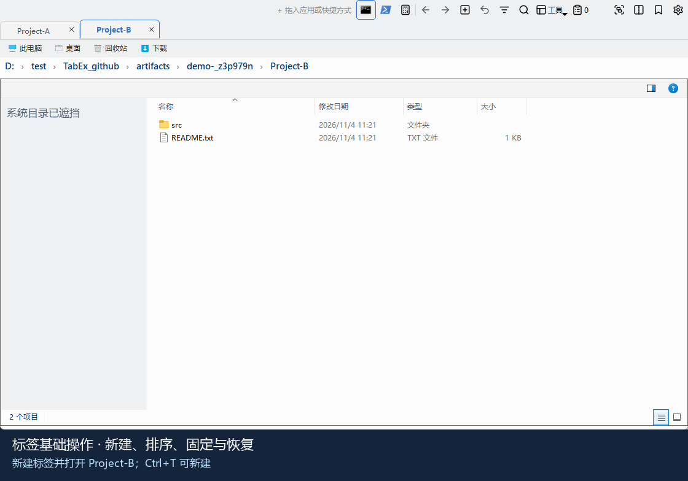

1. 按 `Ctrl+T` 新建标签，输入目标目录。
2. 按住标签标题拖到另一个标签左侧，调整排列顺序。
3. 右键标签选择“固定”，将常用目录留在左侧。
4. 切换到另一个标签，按 `Ctrl+W` 关闭。
5. 按 `Ctrl+Shift+T` 恢复误关标签。

录制会检查标签顺序实际改变、固定状态生效、关闭后数量减少，以及恢复后实际回到原目录。仅使用示例目录，不操作已有会话。

### 基础上手：书签管理

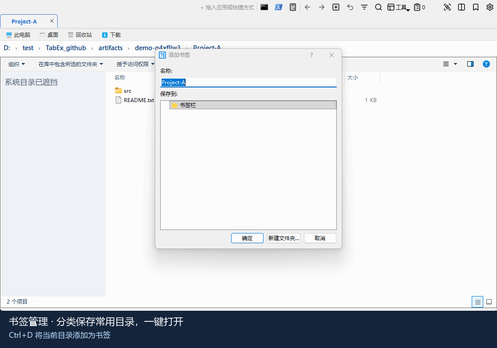

1. 打开常用目录，按 `Ctrl+D`。
2. 在添加书签窗口填写名称，点击“新建文件夹”创建 `Demo Projects` 分类。
3. 选中该分类，确认保存。
4. 从书签按钮打开书签列表，查看分类和保存的书签。
5. 点击书签栏上的 `Demo Projects` 分类，再点击 `Project-A`，打开对应目录。

动图使用真实添加书签、创建文件夹和书签菜单操作；校验书签确实位于目标分类中，且点击后原生文件视图实际打开该目录。书签列表中的内置系统路径会在导出时遮挡，只保留示例路径。

### 基础上手：标题栏启动区

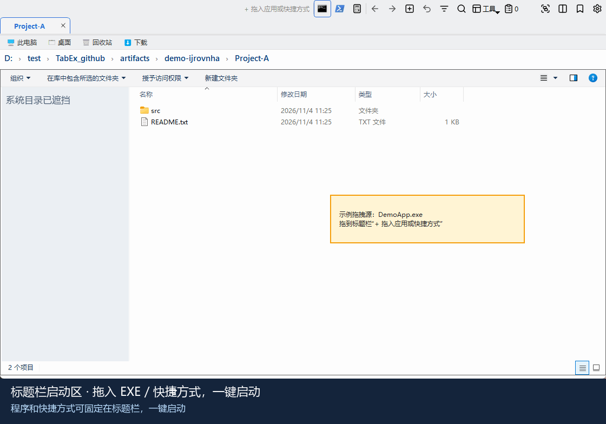

1. 将 `.exe` 拖到标题栏“+ 拖入应用或快捷方式”区域。
2. `.lnk` 快捷方式同样可以拖入，添加后显示启动按钮。
3. 左键点击按钮启动对应程序。
4. 按住快捷方式按钮，拖到另一个按钮右侧，调整顺序。
5. 右键按钮选择“移除该快捷方式”，只移除启动入口，不删除原文件。

演示使用黄色“示例拖拽源”卡片提供真实文件 URL，通过 Windows/Qt 拖放进入现有处理逻辑，不是直接修改启动区配置。`DemoApp.exe` 是本地从 [demo_application.cs](../tools/demo_application.cs) 编译的小程序；`.lnk` 由 Windows 创建，指向该程序。点击 EXE 按钮会真实启动它，显示成功窗口并在约 3 秒后自行退出；脚本核验进程的可执行文件路径，不运行用户已有程序。示例二进制和快捷方式只存在于临时目录，不提交到仓库。

### 基础上手：文件夹拖入标签栏

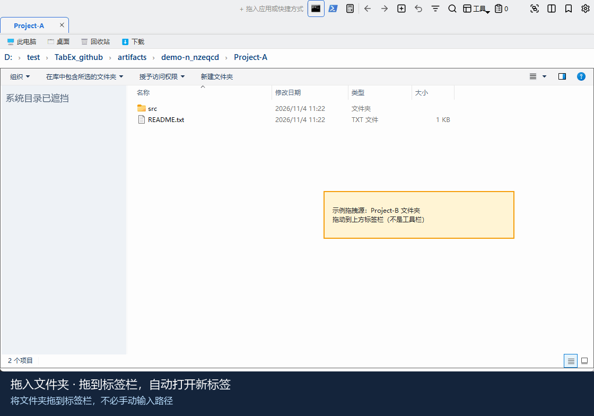

1. 按住文件夹，从文件列表或桌面拖到标签栏。
2. 移动到标签栏区域后松开，文件夹自动在新标签打开。
3. 点击原标签，返回先前的目录。

动图中的黄色卡片是明确标注的示例拖拽源，不是软件新增的界面；使用 `Project-B` 的真实文件夹 URL，展示移动轨迹、目标位置和释放后的结果。校验新标签数量和原生目录导航结果。拖到顶部的程序启动区与拖到标签栏用途不同，不要混淆。

### 效率工具：屏幕截图

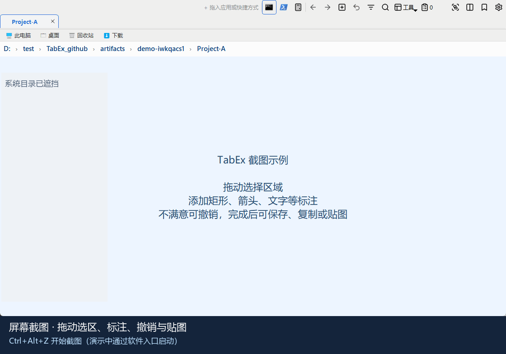

1. 按 `Ctrl+Alt+Z`，或从“工具”菜单启动截图。
2. 按住左键拖动选择区域。
3. 点击矩形工具，在选区内拖动添加标注。
4. 点击撤销，移除刚才的矩形。
5. 点击箭头工具，拖动绘制箭头。
6. 点击贴图，让标注后的截图悬浮桌面；双击贴图或按 `Esc` 可关闭。

为保护桌面隐私，录制先用同进程的示例说明板覆盖文件区，再由真实截图控制器抓取桌面；选区、工具栏、标注、撤销和贴图均来自软件本身。脚本校验选区有效、矩形与箭头真正生成、撤销清除标注，以及贴图像素非空。动图不执行复制或保存，不修改系统剪贴板、不弹出系统保存窗口；字幕和教程仍说明这些可用操作。全局截图热键在录制配置中禁用，录制通过软件入口调用同一控制器。

### 1. 多标签浏览

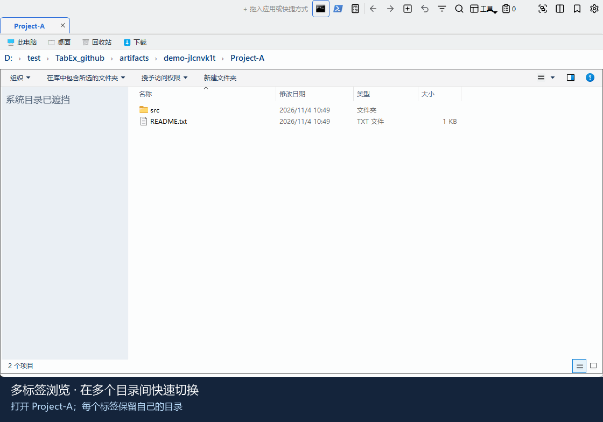

1. 在地址栏打开第一个目录。
2. 按 `Ctrl+T` 新建标签，在地址栏打开第二个目录；按需重复。
3. 点击标签标题，在已打开的目录间切换。

演示依次打开 `Project-A`、`Project-B`、`Documents`，最后返回 `Project-A`。新建标签的默认目录不一定就是演示目录，需要手动输入目标路径。

### 2. 标签分组

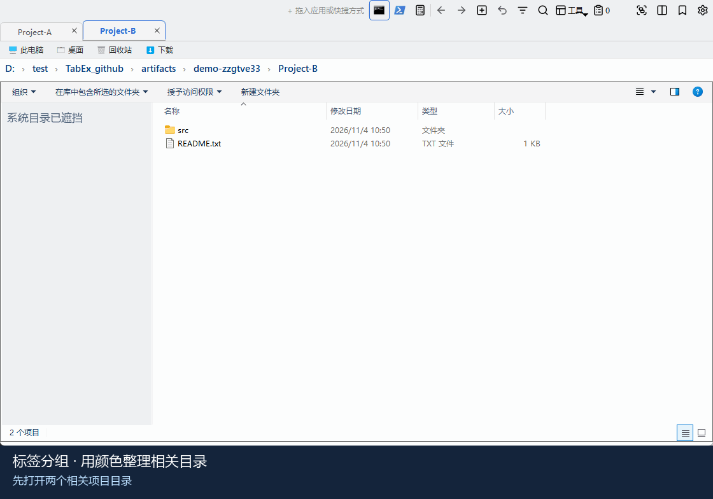

1. 连续打开两个相关目录，并选择右边的标签。
2. 按 `F4`，将当前标签及左侧连续未分组标签组成同色分组。
3. 点击标签栏上的分组色块，折叠或展开该组。

折叠不关闭标签。已分组标签再次按 `F4` 只取消当前标签的分组；固定标签不参与分组。本动图只演示创建、折叠与展开。

### 3. 左右分屏与同步导航

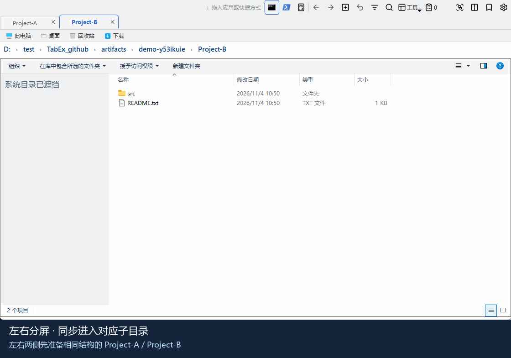

1. 打开 `Project-A` 和 `Project-B`，选择 `Project-B` 标签。
2. 按 `F3`，将当前标签移入右侧分屏。
3. 点击分屏操作条上的“同步导航”，开启同步。
4. 在左侧进入 `src`，右侧自动进入 `Project-B` 下的 `src`。

两侧目录需要存在对应子目录。同步按相对路径跟随，不同步滚动条、选中项或文件内容；目标不存在时提示而不强制跳转。再次按 `F3` 合并回左侧。

### 4. 文件内容搜索

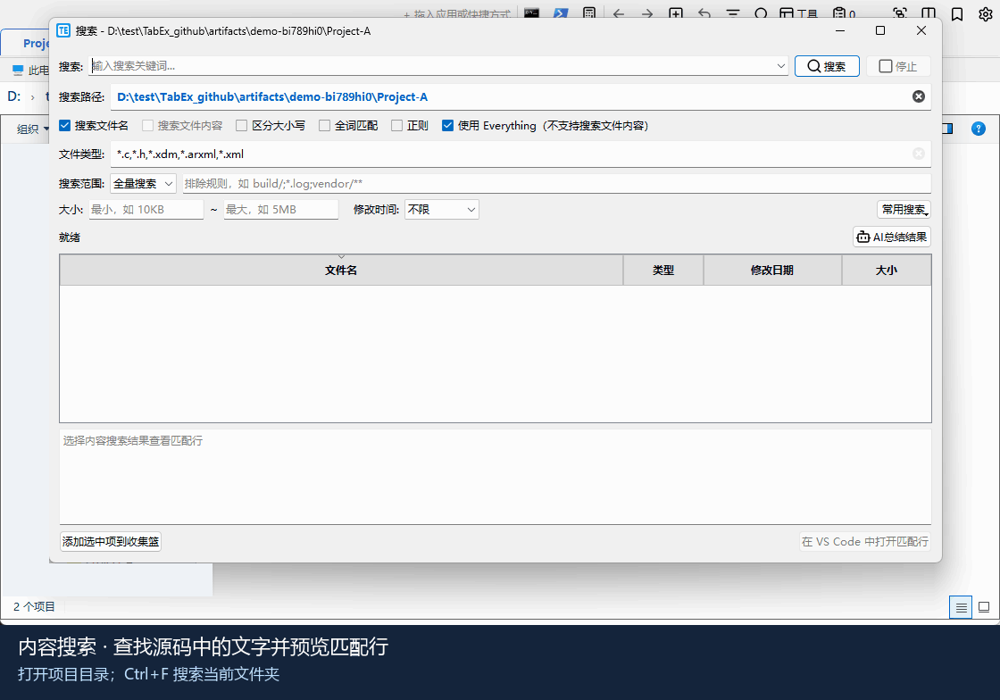

1. 打开实际项目目录，按 `Ctrl+F`。
2. 取消“使用 Everything”，取消“搜索文件名”，勾选“搜索文件内容”。
3. 文件类型填写 `py`，关键词填写 `TabEx demo match`，点击搜索。
4. 选择结果，查看匹配行预览；可选用自行安装的 VS Code 打开匹配行。

示例命中 `src/main.py` 第 2 行。内容搜索使用内置 ripgrep，无需联网；该演示不依赖 Everything、VS Code 或 AI 服务，也不会启动外部编辑器。

### 5. 功能搜索

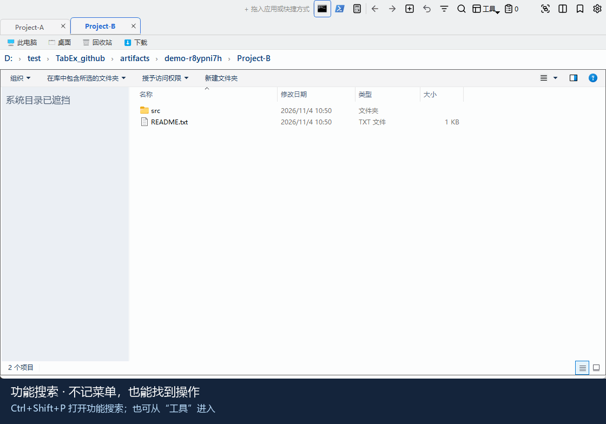

1. 按 `Ctrl+Shift+P`，或选择“工具 → 查找功能”。
2. 输入“分屏”，筛选已有操作。
3. 选择“分屏对比”，回车执行。

不可用功能会显示原因，不会因为搜索到它就强行执行。演示使用真实功能搜索对话框，最终确实进入分屏。

### 6. 文件收集篮

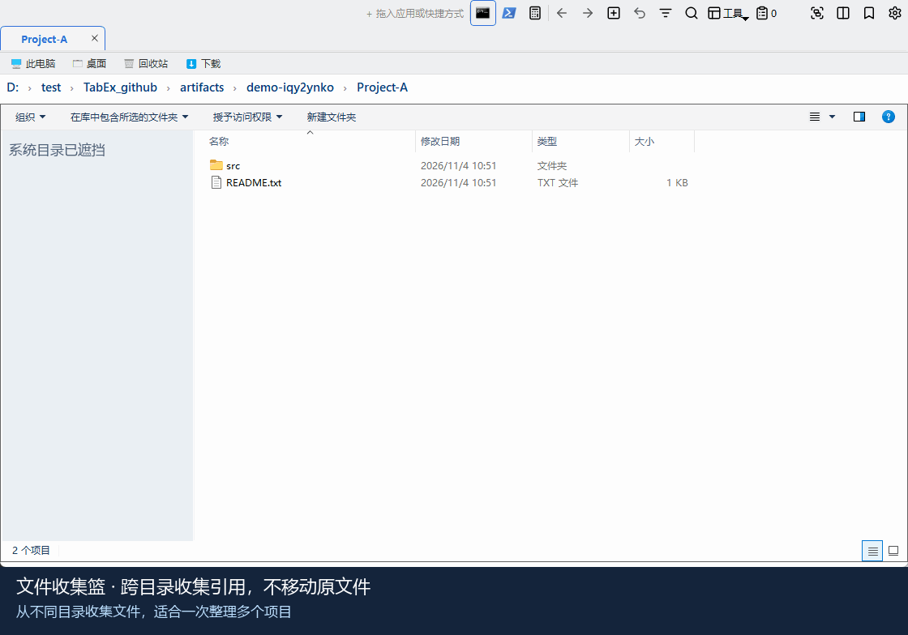

1. 在文件列表中选择文件，通过“工具”中的“添加选中项到收集篮”收集。
2. 切换目录，继续收集；打开“文件收集篮”统一查看。
3. 同一路径重复添加会去重；可统一复制文件或路径。
4. 点击“清空收集篮”，只清空引用，不删除原文件。

演示脚本直接调用现有收集入口，添加两份不同目录的 `README.txt`，重复添加后仍为两项，最后清空并检查原文件仍存在。为避免修改系统剪贴板和产生文件任务，本动图不执行复制。

## 文件与职责

| 文件 | 用途 |
|---|---|
| [README.md](../README.md) | GitHub 仓库首页的演示入口和精选展示 |
| [demos/](demos/) | 11 个可直接在 GitHub 显示的 GIF；必须随文档一起提交 |
| [generate_feature_demos.py](../tools/generate_feature_demos.py) | 创建隔离数据、执行真实操作、录制、遮挡导航树和校验 GIF |
| [demo_application.cs](../tools/demo_application.cs) | 启动区演示专用程序源码，录制时在临时目录编译 |
| [requirements-demo.txt](../requirements/requirements-demo.txt) | 可选的演示制作依赖；不加入发布版运行依赖 |
| [test_feature_demos.py](../tests/test_feature_demos.py) | 检查示例数据、文档入口、动画时长、尺寸、循环和体积 |

## 一次配置，按需重录

在仓库根目录打开 PowerShell。使用项目自带解释器，不使用系统 Python：

```powershell
powershell -NoProfile -ExecutionPolicy Bypass -File .\tools\project_python.ps1 -Action Ensure
.\.venv\python-3.13.13\python.exe -X utf8 -m pip --isolated install --no-user -r .\requirements\requirements-demo.txt
```

如果将来项目解释器位置变化，以 `tools\project_python.ps1` 的输出为准更新这里的命令。

录制前：

- 使用已解锁的 Windows 桌面，主屏至少 `1120 × 700`，显示缩放设为 **100%**。
- 暂停鼠标/键盘操作，关闭通知和悬浮窗；不要锁屏、切换前台窗口或切换显示器。
- 一次只运行一个录制脚本；录制期间会临时打开置顶的 TabEx 窗口。
- 脚本不会接管已有 TabEx 窗口；使用独立数据目录，并关闭 Explorer 监听、自动更新和全局截图热键。
- 拖拽与截图演示会暂时移动鼠标并按下/释放左键，完成后恢复原鼠标位置。不要在录制期间操作其他程序。
- 原生拖放进入 Windows OLE 消息循环，鼠标输入由短生命周期线程驱动，避免 Qt 定时器在嵌套拖放中延迟释放；输入线程结束后才继续录制，并带 6 秒拖放看门狗。
- `launcher` 演示另需 Windows 的 .NET Framework 4 C# 编译器（`%WINDIR%\Microsoft.NET\Framework64\v4.0.30319\csc.exe`）；缺失时明确失败，不会下载外部 EXE 或启动用户的应用。

全部重新生成：

```powershell
.\.venv\python-3.13.13\python.exe -X utf8 .\tools\generate_feature_demos.py
```

只重录受影响的功能，避免无关 GIF 因时间戳变化而改动：

```powershell
.\.venv\python-3.13.13\python.exe -X utf8 .\tools\generate_feature_demos.py --only split content-search
```

支持的名称：`tabs`、`tab-basics`、`bookmarks`、`folder-drop`、`launcher`、`screenshot`、`groups`、`split`、`content-search`、`command-palette`、`file-basket`。

只重录本次补充的基础功能和截图：

```powershell
.\.venv\python-3.13.13\python.exe -X utf8 .\tools\generate_feature_demos.py --only tab-basics bookmarks folder-drop launcher screenshot
```

先预览候选版本、不覆盖正式动图：

```powershell
.\.venv\python-3.13.13\python.exe -X utf8 .\tools\generate_feature_demos.py --only split --output .\artifacts\demo-preview
```

每个功能在独立子进程中运行，示例数据在 `artifacts\demo-*` 临时目录生成；正常结束或普通异常会清理。通过校验的候选 GIF 才替换同名正式文件。任一功能失败会返回非零退出码，后续功能不再继续；此前成功生成的文件保留。强制终止可能留下临时目录，确认没有录制进程使用后，只删除那一个明确的 `demo-*` 目录。

## 隐私与画面说明

- 所有被操作文件均为脚本创建的示例文件，不读取真实配置、书签或聊天历史，不发送截图到外部服务。
- 原生 Explorer 导航树仍来自当前 Windows 环境，因此导出时整块遮挡；这是隐私处理，不是软件本身隐藏了导航树。
- 书签列表中的内置路径也在导出时遮挡；截图演示只选取示例说明板，避免把真实目录树烧录进贴图。
- 地址栏与搜索结果仍显示示例数据的绝对路径。若仓库路径含姓名或其他敏感信息，应在非敏感路径下录制；不要未经检查就发布。
- 其他进程窗口覆盖录制区域、录制窗口尺寸变化或空白截屏会使录制失败，不会以成功结果掩盖问题。对话框的可见边界由 Windows DWM 获取，遮挡导航树时保留前景对话框的内容。
- 动图使用真实屏幕捕获，以包含原生文件列表；普通 Qt 控件截图可能漏掉嵌入的 Explorer 内容。

## 维护步骤

1. 功能界面或默认快捷键变化后，找到脚本中对应 `name` 分支，更新步骤、字幕和真实结果等待条件；不要用伪造结果替代失效操作。
2. 只重录发生变化的功能，同时更新本文的操作步骤、制作版本/日期，以及首页对应说明。
3. 新增演示时，将名称加入 `DEMOS`，补充分支和标题，并在本文及首页添加图片入口；优先独立短步骤，不把多个复杂流程合成一个大 GIF。
4. 只保留最终 GIF。原始帧存在内存中，不提交临时目录、日志或本机配置。
5. 提交前执行以下校验并人工预览：

```powershell
.\.venv\python-3.13.13\python.exe -X utf8 .\tools\generate_feature_demos.py --check
.\.venv\python-3.13.13\python.exe -X utf8 -m unittest discover -s tests -p test_feature_demos.py
git --no-pager diff --check
```

自动校验要求：`1120 × 784`（底部 84 像素为字幕）、无限循环、至少 2 帧、总时长 **8–20 秒**、每张不超过 **3 MiB**。捕获间隔为 200 ms；较长的录制会均匀加速播放，目标不超过 18 秒，保留所有捕获帧并在终端输出加速倍率。相同帧会合并，保存的帧数不等于时长乘以采样频率；人工预览时仍需确认字幕可读。默认未安装 Pillow 时，普通测试中的 GIF 编码校验会跳过；正式发布动图前应安装演示依赖并完整执行。

人工发布清单：

- [ ] 每张动画从头到尾播放，字幕、默认快捷键与当前版本一致。
- [ ] 文件列表真实可见，没有空白原生视图、截断对话框或其他窗口覆盖。
- [ ] 分屏两侧确实进入对应目录；搜索结果确实显示目标匹配行。
- [ ] 拖拽有清楚的起点和落点；启动区确实出现示例程序窗口；截图确实生成带箭头的悬浮贴图。
- [ ] 所有帧的导航树均被遮挡，地址栏没有敏感路径。
- [ ] README Markdown 预览中图片可加载，折叠项可展开；检查仓库提交中包含对应 GIF。
- [ ] 推送后在 GitHub 首页检查显示效果；本地生成不会自动更新远端主页。

## 常见失败

| 现象 | 处理 |
|---|---|
| 缺少 Pillow 或 PyQt5 | 用项目解释器安装 `requirements-demo.txt` |
| 提示缺少 C# 编译器 | 确认 Windows 已启用 .NET Framework 4；其他演示可用 `--only` 单独生成 |
| 提示窗口遮挡或尺寸变化 | 关闭通知/悬浮窗口，不调整窗口大小，重录该项 |
| 原生目录加载超时 | 确认桌面未锁定，等待系统响应后重试；若仍失败，检查对应真实功能 |
| 按钮或结果等待条件失效 | 根据当前源码更新录制分支；不要删除结果检查来“通过” |
| 超过体积或时长限制 | 减少不必要的等待和操作，或拆成单功能演示 |
| 首页图片不显示 | 确认 `docs\demos\` 已提交，文件名大小写及相对路径一致 |
